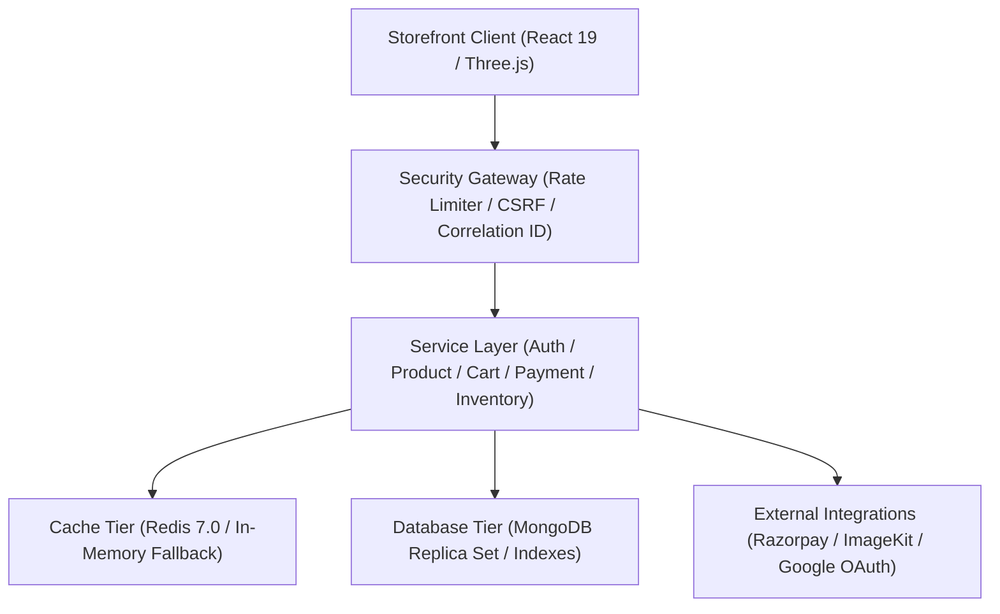

# SNITCH — Production-Grade 3D Fashion E-Commerce Marketplace

An enterprise-ready, scalable, and secure fashion marketplace engineered with **Next.js 16 (App Router)**, **React 19**, **Three.js (React Three Fiber & Drei)**, **MongoDB / Mongoose**, **Redis**, and **Razorpay**, designed around a clean modular monolithic backend architecture.

---

## 1. Architectural Highlights

- **Modular Monolithic Architecture**: Clear separation of concerns across controllers, domain services (`lib/server/services`), data repositories (`lib/server/repositories`), validators (`lib/server/validators`), and database models.
- **Enterprise Authentication & RBAC**: Dual-token JWT architecture (15-minute access token + 30-day SHA-256 hashed refresh token with token rotation, replay detection, and active session revocation), HttpOnly SameSite cookies, bcrypt password hashing, and Role-Based Access Control (`buyer`, `seller`, `admin`).
- **Resilient Financial Transactions (Razorpay)**:
  - 100% server-side amount calculation (frontend amounts are never trusted).
  - Timing-safe HMAC-SHA256 signature verification.
  - Dedicated webhook endpoint with raw-body cryptographic verification.
  - Idempotent payment processing preventing duplicate orders.
- **Two-Phase Atomic Inventory Locking**:
  - 10-minute temporary stock reservations during checkout using MongoDB atomic conditional updates (`$inc` where `stock >= quantity`).
  - Automatic reservation release on payment failure or cancellation.
  - Periodic automated sweep of expired reservations.
  - Guaranteed negative stock prevention under concurrent purchases.
- **Multi-Tier Caching & Graceful Degradation**:
  - Redis cache-aside strategy for catalog listings, product details, and category taxonomies.
  - Seamless automated fallback to an in-memory TTL cache if Redis is unconfigured or offline.
- **Background Task Processing**:
  - Asynchronous task execution with BullMQ and Redis with automatic retry, exponential backoff, and in-process fallback execution for notifications and maintenance jobs.
- **Interactive 3D Storefront**:
  - Three.js / React Three Fiber / Drei lazy-loaded 3D garment viewer with real-time colorway tinting, low-power demand rendering, and automatic GPU memory cleanup.
- **Automated Testing & CI/CD**:
  - Vitest unit & integration test suites covering all commerce workflows.
  - Playwright end-to-end testing suite.
  - GitHub Actions automated CI pipeline (`.github/workflows/ci.yml`).
  - Multi-stage non-root Alpine Docker container and `docker-compose.yml`.

---

## 2. Technology Stack

| Domain | Technologies |
| :--- | :--- |
| **Frontend Runtime** | Next.js 16 (App Router), React 19, TypeScript, Sass (SCSS) |
| **Motion & Editorial**| Framer Motion 12, GSAP 3, ScrollTrigger |
| **3D Rendering** | Three.js 0.177, React Three Fiber 9, Drei 10 |
| **Backend & APIs** | Next.js Route Handlers, Node.js 20+, Zod 4 |
| **Database** | MongoDB 7.0, Mongoose 9 (Optimized Compound Indexes & Aggregations) |
| **Caching & Queues**| Redis 7.0, ioredis 6, BullMQ 6 (with in-memory fallback) |
| **Payments** | Razorpay Node SDK (Order creation, signature verification, webhooks, refunds) |
| **Media Hosting** | ImageKit Node SDK (Validated multi-image uploads) |
| **Quality & DevOps**| Vitest 5, Playwright, Docker, Docker Compose, GitHub Actions, k6 |

---

## 3. High-Level Architecture



---

## 4. Local Quick Start

### 4.1 Prerequisites
- Node.js 20.9+ and npm
- MongoDB (local service or MongoDB Atlas connection string)
- Redis (optional — falls back automatically to in-memory caching)

### 4.2 Installation
```bash
git clone <repo-url>
cd snitch
npm install
```

### 4.3 Environment Configuration
Create `.env.local` in the project root:
```env
PORT=5173
NODE_ENV=development
MONGO_URI=mongodb://127.0.0.1:27017/snitch
JWT_SECRET=super_secret_jwt_key_at_least_32_characters_long
JWT_REFRESH_SECRET=super_secret_refresh_key_32_characters_long
REDIS_URL=redis://127.0.0.1:6379

# Payments (Razorpay Test Mode)
RAZORPAY_KEY_ID=rzp_test_your_key_id
RAZORPAY_KEY_SECRET=your_razorpay_secret
RAZORPAY_WEBHOOK_SECRET=your_webhook_secret

# Media Storage (ImageKit)
IMAGEKIT_PRIVATE_KEY=your_imagekit_private_key

# Google OAuth (Optional)
GOOGLE_CLIENT_ID=your_google_client_id
GOOGLE_CLIENT_SECRET=your_google_client_secret
GOOGLE_CALLBACK_URL=http://localhost:5173/auth/google/callback
```

### 4.4 Running Locally
```bash
npm run dev
```
Open `http://localhost:5173` to explore the editorial storefront.

---

## 5. Docker Infrastructure

To run the complete production environment (Application + Redis + MongoDB):
```bash
docker compose up -d --build
```

---

## 6. Testing

Run all unit, integration, and workflow tests:
```bash
# Run unit & integration test suite
npm run test

# Run tests with code coverage analysis
npm run test:coverage

# Run Playwright E2E tests
npm run test:e2e
```

---

## 7. Comprehensive Documentation

Detailed architectural and engineering documentation is available in `docs/`:

- [PROJECT_AUDIT.md](file:///c:/Users/rp512/OneDrive/Desktop/Snitch/docs/PROJECT_AUDIT.md) — Comprehensive repository audit, identified vulnerabilities, and transformation roadmap.
- [ARCHITECTURE.md](file:///c:/Users/rp512/OneDrive/Desktop/Snitch/docs/ARCHITECTURE.md) — Full modular monolithic system architecture specification.
- [SECURITY.md](file:///c:/Users/rp512/OneDrive/Desktop/Snitch/docs/SECURITY.md) — Threat model, authentication, CSRF, rate limiting, and RBAC implementation.
- [DATABASE_DESIGN.md](file:///c:/Users/rp512/OneDrive/Desktop/Snitch/docs/DATABASE_DESIGN.md) — MongoDB schema design, indexes, and two-phase atomic inventory locking.
- [API_DOCUMENTATION.md](file:///c:/Users/rp512/OneDrive/Desktop/Snitch/docs/API_DOCUMENTATION.md) — OpenAPI 3.0 specification for all REST endpoints.
- [PERFORMANCE_REPORT.md](file:///c:/Users/rp512/OneDrive/Desktop/Snitch/docs/PERFORMANCE_REPORT.md) — k6 load testing benchmarks, throughput, and Web Vitals targets.
- [TESTING.md](file:///c:/Users/rp512/OneDrive/Desktop/Snitch/docs/TESTING.md) — Vitest & Playwright automated testing strategy.
- [DEPLOYMENT.md](file:///c:/Users/rp512/OneDrive/Desktop/Snitch/docs/DEPLOYMENT.md) — Production deployment, Docker containerization, and monitoring probes.
