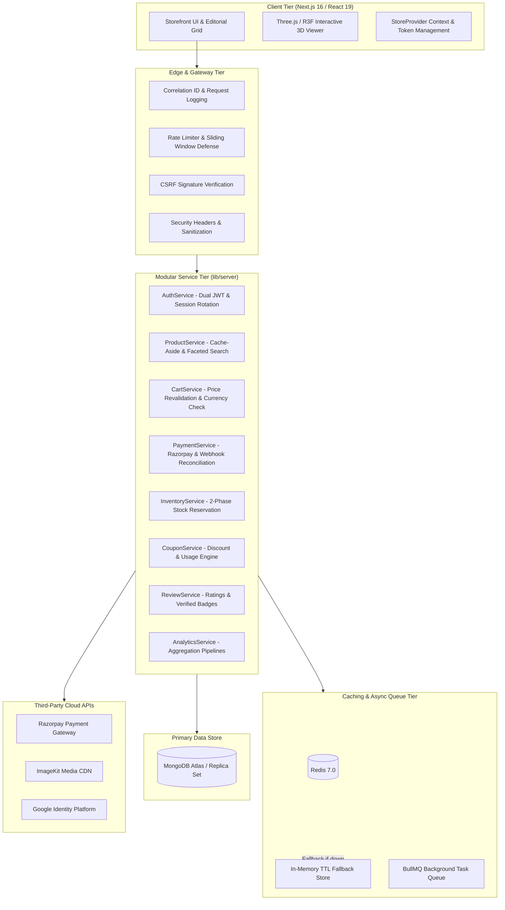

# SNITCH — Production Architecture Specification

**System Classification:** Production-Grade Modular Monolithic 3D Fashion E-Commerce Marketplace  
**Engineered For:** Scalability, High Concurrency, Fault Tolerance, and Strict Financial Consistency  

---

## 1. High-Level Architecture Diagram

---

## 2. Layered Architecture Principles

### 2.1 Route Handlers as Thin Controllers
All Next.js route handlers (`app/api/*`) are strictly limited to:
1. Extracting parameters, query strings, and headers.
2. Validating incoming inputs using strict Zod schemas.
3. Authenticating the actor and ensuring role-based access permissions.
4. Delegating core business operations to the corresponding domain service.
5. Returning standardized HTTP responses with correlation tracking (`x-request-id`).

### 2.2 Domain Service Layer (`lib/server/services`)
Contains all business logic, financial calculations, state transitions, cache coordination, and domain invariants:
- **`AuthService`**: Access token signing (15 min), cryptographically secure refresh token rotation, session revocation.
- **`PaymentService`**: Server-side amount computation from DB, Razorpay order creation, timing-safe signature verification, idempotent webhook processing.
- **`InventoryService`**: Two-phase atomic stock locking (`$inc`), reservation expiration sweeps, preventing overselling.
- **`ProductService`**: Full-text searching, category filtering, cache-aside lookup, seller listing creation and variant updates.

### 2.3 Repository Tier (`lib/server/repositories`)
Encapsulates all database interactions, Mongoose queries, index hints, lean projections, and data mappings:
- Pure data access functions decoupled from HTTP contexts.
- Supports both single-document queries and transactional sessions (`ClientSession`).

### 2.4 Resilient Infrastructure Degradation
- **Redis Resilience**: If Redis is unconfigured or experiences downtime, the system automatically degrades to an in-memory TTL cache without crashing or failing requests.
- **Queue Resilience**: If BullMQ Redis is unreachable, background jobs execute asynchronously via in-process `setImmediate` queues.
- **Source of Truth**: MongoDB remains the sole source of truth for transactions, payments, and inventory.

