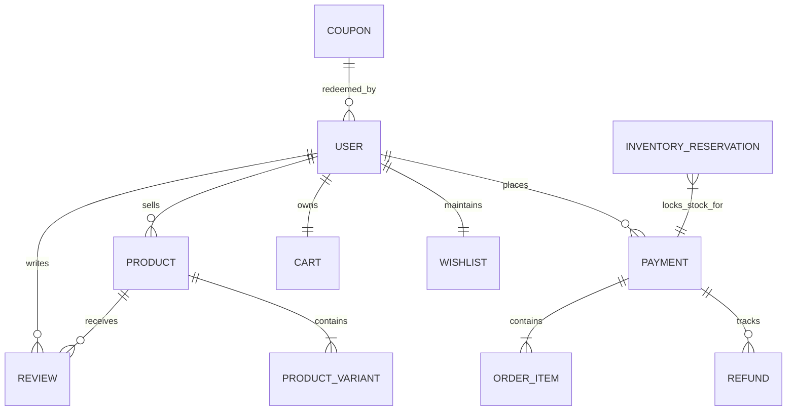

# SNITCH — Database Architecture & Optimization Guide

**Database:** MongoDB  
**Object Document Mapper:** Mongoose  
**Architecture:** Optimized Document Model with Referential Integrity & Atomic Operations  

---

## 1. Collections & Relationships



### 1.1 Collection Schemas

| Collection | Primary Key | Purpose | Critical Fields |
| :--- | :--- | :--- | :--- |
| **`users`** | `_id (ObjectId)` | Buyer, seller & admin identities | `email` (unique), `password`, `role`, `refreshTokens[]`, `isSuspended` |
| **`products`** | `_id (ObjectId)` | Catalog items & variants | `title`, `seller`, `price`, `variants[]`, `averageRating`, `reviewCount`, `totalSold` |
| **`payments`** | `_id (ObjectId)` | Order records & payment lifecycles | `user`, `status`, `price`, `razorpay`, `orderItems[]`, `refunds[]`, `shippingAddress` |
| **`carts`** | `_id (ObjectId)` | Persistent shopping bags | `user` (ref), `items[]` (`product`, `variant`, `quantity`) |
| **`wishlists`** | `_id (ObjectId)` | Customer saved items | `user` (unique), `products[]` |
| **`reviews`** | `_id (ObjectId)` | Ratings & verified feedback | `product`, `user`, `rating`, `isVerifiedPurchase` (compound unique `product+user`) |
| **`coupons`** | `_id (ObjectId)` | Promotional discount engine | `code` (unique), `discountType`, `discountValue`, `expiresAt`, `usageLimit`, `usedBy[]` |
| **`inventory_reservations`** | `_id (ObjectId)` | Temporary stock lock during checkout | `orderId`, `userId`, `items[]`, `status`, `expiresAt` (TTL index) |
| **`audit_logs`** | `_id (ObjectId)` | Immutable security & transaction trail | `entityType`, `entityId`, `action`, `actor`, `metadata`, `timestamp` |
| **`webhook_events`** | `_id (ObjectId)` | Idempotent webhook tracking | `eventId` (unique), `provider`, `event`, `processed` |

---

## 2. Production Indexing Strategy

All indexes are designed to optimize high-traffic query patterns while preventing unnecessary write overhead:

### `users`
- `{ email: 1 }` (unique): Fast lookup during authentication.
- `{ googleId: 1 }` (sparse): Google OAuth single sign-on lookup.
- `{ role: 1 }`: Role-based filtering.

### `products`
- `{ category: 1, isActive: 1, "price.amount": 1 }`: Compound index powering faceted storefront filters.
- `{ seller: 1, createdAt: -1 }`: Seller studio listings query.
- `{ isActive: 1, averageRating: -1 }`: Top-rated product queries.
- `{ isActive: 1, createdAt: -1 }`: New arrivals sorting.
- Text Index on `{ title: "text", description: "text", category: "text", tags: "text" }` with weighted relevance for full-text search.

### `payments` (Orders)
- `{ user: 1, createdAt: -1 }`: Buyer order history.
- `{ "razorpay.orderId": 1 }`: Razorpay signature verification and webhook reconciliation.
- `{ "orderItems.sellerId": 1, status: 1, createdAt: -1 }`: Seller fulfillment dashboard queries.
- `{ "orderItems.productId": 1, createdAt: -1 }`: Verified purchase verification for reviews.

### `inventory_reservations`
- `{ expiresAt: 1 }` (`expireAfterSeconds: 86400`): Automated TTL cleanup of expired reservation documents.
- `{ orderId: 1, status: 1 }`: Fast lookup during payment commit or release.

### `reviews`
- `{ product: 1, user: 1 }` (unique): Prevents duplicate reviews per customer per piece.
- `{ product: 1, createdAt: -1 }`: Chronological product review displays.

### `coupons`
- `{ code: 1, isActive: 1 }`: High-speed coupon code validation.

---

## 3. Transaction Boundaries & Concurrency

### 3.1 Two-Phase Stock Reservation & Deductions

To prevent overselling without requiring long-lived locks or distributed distributed transactions, SNITCH uses **MongoDB atomic conditional updates**:

1. **Phase 1: Temporary Reservation (`createPaymentOrder`)**
   ```javascript
   Product.updateOne(
     {
       _id: productId,
       variants: { $elemMatch: { _id: variantId, stock: { $gte: quantity } } }
     },
     {
       $inc: {
         "variants.$.stock": -quantity,
         "variants.$.reservedStock": quantity
       }
     }
   )
   ```
   - If update count is 0, the operation aborts and releases previously reserved items in the cart.
   - An `InventoryReservation` record is created with a 10-minute expiration timestamp.

2. **Phase 2A: Commit on Verified Payment (`verifyPayment` / `payment.captured`)**
   ```javascript
   Product.updateOne(
     { _id: productId, "variants._id": variantId },
     {
       $inc: {
         "variants.$.reservedStock": -quantity,
         "variants.$.soldStock": quantity,
         totalSold: quantity
       }
     }
   )
   ```

3. **Phase 2B: Automatic Release on Failure or Expiration (`sweepExpiredReservations`)**
   ```javascript
   Product.updateOne(
     { _id: productId, "variants._id": variantId },
     {
       $inc: {
         "variants.$.stock": quantity,
         "variants.$.reservedStock": -quantity
       }
     }
   )
   ```

### 3.2 Data Consistency Strategy
- **Lean Queries (`.lean()`)**: Applied to all read-only storefront queries to eliminate Mongoose document overhead and reduce memory allocations.
- **Idempotent Webhooks**: Every incoming webhook checks `WebhookEvent` table by `eventId`. Duplicate deliveries return HTTP 200 immediately without re-processing payments or inventory.

