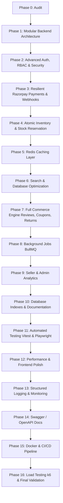

# SNITCH — Comprehensive Repository Audit & Architectural Assessment

**Project:** SNITCH (Production-Grade E-Commerce Marketplace)  
**Date:** November 2026  
**Auditor:** Senior Software Architect, Application Security & DevOps Engineering Team  

---

## 1. Executive Summary

SNITCH is a full-stack fashion e-commerce marketplace built on Next.js 16 (App Router), React 19, TypeScript, SCSS, Framer Motion, GSAP, and Three.js (React Three Fiber & Drei), backed by MongoDB and Mongoose. It integrates Razorpay for payments, ImageKit for product media hosting, and Google OAuth 2.0 for single sign-on.

While the existing system provides an aesthetically refined editorial storefront and working baseline commerce flows (buyer shopping bag, checkout with Razorpay test mode, seller listing studio, and multi-step order fulfillment), significant architectural, security, scalability, and resilience gaps must be resolved to elevate it to a production-grade enterprise standard.

---

## 2. Existing System Architecture

### 2.1 Technology Stack Inventory

| Component | Current Technology | Version | Assessment |
| :--- | :--- | :--- | :--- |
| **Framework** | Next.js (App Router) | `16.0.0` | Modern, React 19 server/client components. |
| **Frontend Runtime** | React & React-DOM | `19.2.4` | Latest concurrent features. |
| **Styling** | Sass (SCSS) | `1.89.2` | Clean bespoke editorial theme with dark/light mode. |
| **Animations** | Framer Motion & GSAP | `12.23.12` / `3.13.0` | High-quality editorial reveals and micro-interactions. |
| **3D Rendering** | Three.js, R3F, Drei | `0.177.0` / `9.1.2` / `10.7.7` | Lazy-loaded GLB viewer with tinting and camera controls. |
| **Database** | MongoDB / Mongoose | `9.12.0` | Document database for catalog, cart, orders, and users. |
| **Auth** | JWT (`jsonwebtoken`) & `bcryptjs` | `9.0.3` / `3.0.3` | Single 7-day token in HttpOnly cookie; basic Google OAuth. |
| **Payments** | Razorpay Node SDK | `2.9.8` | Client-initiated order creation & signature verification. |
| **Media Hosting** | `@imagekit/nodejs` | `7.14.0` | Up to 7 images per listing uploaded to ImageKit folder. |

### 2.2 Existing Codebase Structure

```
Snitch/
├── app/
│   ├── api/[...segments]/route.ts       # Monolithic catch-all route dispatcher
│   ├── auth/google/callback/route.ts    # Google OAuth callback handler
│   ├── cart/page.tsx                    # Buyer cart & Razorpay checkout
│   ├── login/page.tsx                   # Login page
│   ├── order-success/page.tsx           # Checkout confirmation
│   ├── orders/page.tsx                  # Buyer order history
│   ├── product/[productId]/page.tsx     # Product detail + 3D viewer
│   ├── profile/page.tsx                 # User account settings
│   ├── register/page.tsx                # Buyer/seller registration
│   ├── seller/
│   │   ├── create-product/page.tsx      # Product listing form
│   │   ├── dashboard/page.tsx           # Seller listings & fulfillment
│   │   └── product/[productId]/page.tsx # Variant & inventory management
│   ├── wishlist/page.tsx                # Saved items
│   ├── layout.tsx & globals.scss        # Root layout and editorial styles
│   └── page.tsx                         # Editorial storefront
├── components/                          # UI & Three.js canvas components
├── hooks/                               # useProtectedRoute
├── lib/
│   ├── api.ts                           # Client-side fetch wrapper
│   ├── motion.ts                        # Scroll & entrance animations
│   ├── razorpay.ts                      # Lazy Razorpay checkout script loader
│   └── server/
│       ├── auth-api.ts                  # Auth route handlers
│       ├── auth.ts                      # JWT verification & session helpers
│       ├── cart.ts                      # Cart & checkout business logic
│       ├── db.ts                        # Mongoose global connection cache
│       ├── env.ts                       # Environment variable accessor
│       ├── errors.ts                    # ApiError & error response helper
│       ├── orders.ts                    # Order retrieval & fulfillment updates
│       ├── products.ts                  # Product CRUD & variant updates
│       ├── upload.ts                    # ImageKit upload handler
│       ├── wishlist.ts                  # Wishlist operations
│       └── models/                      # User, Product, Payment, Cart, Wishlist
└── types/                               # TypeScript declarations
```

---

## 3. Detailed Audit Findings & Vulnerability Analysis

### 3.1 Security & Authentication Weaknesses

1. **Single Long-Lived JWT Token (No Refresh / Rotation)**:
   - Users are issued a single 7-day access token stored in the `token` cookie.
   - If a token is compromised, it cannot be revoked before expiration.
   - There is no session store, no refresh token rotation, and no active session revocation mechanism.
2. **Missing Role-Based Access Control (RBAC) for Admin**:
   - The user role enum only supports `"buyer"` and `"seller"`.
   - No `"admin"` role exists in the database schema or middleware.
   - Platform-wide administrative capabilities (catalog moderation, platform analytics, user suspension) are absent.
3. **No Rate Limiting or Brute-Force Protection**:
   - `/api/auth/login` and `/api/auth/register` have no rate limiting or IP-based velocity checks.
   - Vulnerable to automated credential stuffing, password guessing, and denial-of-service.
4. **Missing Anti-CSRF Token Enforcement**:
   - State-changing mutations (e.g., adding variants, cart mutations, checkout, order fulfillment updates) rely on cookies (`SameSite=lax`).
   - No secondary anti-CSRF token verification is enforced for API requests.
5. **No Structured Request Input Validation**:
   - Validation is performed manually using basic string length checks, regular expressions, and ad-hoc conditions inside handlers.
   - There is no schema validation layer (e.g., Zod) ensuring strict type safety, input sanitization, or rejection of malicious extra properties.
6. **No Request Correlation / Tracing**:
   - Requests lack unique correlation IDs (`x-request-id`), making debugging across distributed client-server events difficult.

### 3.2 Payment System Deficiencies

1. **Absence of Razorpay Webhook Integration**:
   - Payment verification relies solely on the buyer's browser executing the frontend `handler` callback to call `/api/cart/payment/verify/order`.
   - If the buyer's network drops, the browser crashes, or the user navigates away before the callback executes:
     - The customer's credit card or bank account is debited by Razorpay.
     - The order remains indefinitely in `pending` state in MongoDB.
     - Stock is never deducted, and the merchant is not notified of the sale.
2. **Missing Stock Reservation Lifecycle**:
   - During `/api/cart/payment/create/order`, the server checks stock availability but does *not* create an atomic temporary reservation.
   - Between order creation and checkout completion (typically 1–3 minutes), another customer can purchase the remaining inventory.
   - This causes payment verification to fail with `Insufficient stock for ...` after the customer has already paid.
3. **Payment State Confusion (`Payment` vs `Order`)**:
   - Order records and payment records are conflated inside a single `Payment` collection.
   - Payment statuses (`CREATED`, `AUTHORIZED`, `CAPTURED`, `FAILED`, `REFUNDED`) are not decoupled from order fulfillment lifecycle statuses (`PENDING`, `PROCESSING`, `SHIPPED`, `DELIVERED`, `CANCELLED`).
4. **Missing Refund & Reconciliation Engine**:
   - No server-side refund capability exists. If an order cannot be fulfilled, manual external intervention in the Razorpay dashboard is required.

### 3.3 Database & Inventory Limitations

1. **Missing MongoDB Indexes**:
   - `Product` has no compound index on `{ category: 1, isActive: 1, "price.amount": 1 }` or text indexes on `{ title: "text", description: "text" }`.
   - Searching relies on case-insensitive regex queries (`$regex`), resulting in collection scans ($COLLSCAN) that will degrade under load.
   - `Payment` lacks indexes on `{ user: 1, createdAt: -1 }`, `{ status: 1 }`, and `{ "orderItems.productId": 1 }`.
2. **Unpaginated Product Queries**:
   - `Product.find(filter)` returns all matching records without `skip`, `limit`, or cursor-based pagination.
   - A catalog of thousands of products will cause high memory consumption and slow HTTP response times.
3. **No Variant-Specific Stock Reservation State**:
   - Variant schemas only store `stock: Number`. There are no fields for `reservedStock`, `soldStock`, or atomic reservation release locks.

### 3.4 Infrastructure, Caching & Background Processing Gaps

1. **No Caching Layer (Redis)**:
   - Every storefront visit, product detail lookup, and category query hits MongoDB directly.
   - No cache-aside strategy for hot products, categories, or session tokens.
2. **Synchronous Execution (No Background Queues)**:
   - All operations run synchronously within the HTTP request lifecycle.
   - No asynchronous BullMQ queue for email notifications, inventory release timers, low-stock warnings, or abandoned checkout follow-ups.
3. **Lack of Automated Testing**:
   - Zero automated tests exist in the repository (no Vitest, no Jest, no Playwright).
   - Any refactoring risks breaking existing features without automated regression detection.
4. **Missing Containerization & CI/CD**:
   - No `Dockerfile`, `docker-compose.yml`, or GitHub Actions workflow (`.github/workflows/ci.yml`) is present.
5. **Missing API Documentation**:
   - No Swagger/OpenAPI documentation exists to document and inspect API contracts.

---

## 4. Remediation & Transformation Roadmap

To transform SNITCH into a production-grade, secure, and resilient marketplace while preserving all existing user experiences, the following incremental phases are established:



### Key Architectural Commitments:
- **Clean Service Layer**: Decouple business logic from Next.js route handlers into `lib/server/services/`, `lib/server/repositories/`, and `lib/server/validators/`.
- **Strict Backward Compatibility**: Keep all existing frontend UI routes and API URL contracts completely functional.
- **Fail-Safe Infrastructure**: Ensure Redis and BullMQ degrade gracefully if external services are not active locally.
- **Zero Mock Data**: All data will be sourced directly from real MongoDB collections and actual transactions.

