# SNITCH — Automated Testing Strategy & Verification Guide

**Frameworks:** Vitest 5.1.0 (Unit & Integration) + Playwright (End-to-End)  
**Execution Environment:** Node.js 20+  

---

## 1. Test Architecture Overview

```mermaid
flowchart TD
    Unit[Unit Tests Vitest] --> Auth[Auth & Security Utils]
    Unit --> Pricing[Pricing & Coupon Engine]
    Unit --> Inventory[Inventory & Stock Math]
    Unit --> Razorpay[Payment Signatures & Fulfillment Transitions]

    Integration[Integration Tests Vitest] --> W1[Workflow 1: Buyer Journey]
    Integration --> W2[Workflow 2: Seller Studio & Inventory]
    Integration --> W3[Workflow 3: Order Progression]
    Integration --> W4[Workflow 4: Stock Rollback on Failure]
    Integration --> W5[Workflow 5: RBAC Role Protection]
    Integration --> W6[Workflow 6: IDOR Protection]
    Integration --> W7[Workflow 7: Webhook Idempotency]
    Integration --> W8[Workflow 8: Concurrency & Anti-Oversell]

    E2E[End-to-End Tests Playwright] --> UI[Editorial Storefront & Navigation]
    E2E --> AuthUI[Login & Register Flows]
    E2E --> BagUI[Shopping Bag & Empty States]
```



---

## 2. Running Automated Tests

### 2.1 Run Unit and Integration Test Suite
```bash
npm run test
```
Executes all test suites in `tests/unit` and `tests/integration` in parallel using Vitest.

### 2.2 Watch Mode (Active Development)
```bash
npm run test:watch
```

### 2.3 Coverage Analysis
```bash
npm run test:coverage
```
Produces detailed line and branch coverage reports using the v8 coverage provider.

### 2.4 End-to-End Tests (Playwright)
```bash
npm run test:e2e
```

---

## 3. Implemented Test Suites

### 3.1 Unit Test Coverage
1. **`tests/unit/auth.test.ts`**:
   - Bcrypt password hashing with work factor 12 and salt verification.
   - Dual-token generation (short-lived access token + SHA-256 hashed refresh token).
   - Safe public user projection (ensuring password hashes and sessions are never returned).
   - Zod schema validation for registration, login, and profile updates.
2. **`tests/unit/pricing-and-coupon.test.ts`**:
   - Currency formatting across INR and international currencies.
   - Percentage discount calculations capped at `maxDiscount`.
   - Fixed discount calculations with non-negative price bounds.
3. **`tests/unit/inventory.test.ts`**:
   - Dynamic variant status classification (`in_stock`, `low_stock`, `out_of_stock`).
   - Atomic reservation invariant checks: `availableStock + reservedStock + soldStock == totalPhysicalStock`.
   - Reservation expiration detection and stock restoration.
4. **`tests/unit/payment-and-orders.test.ts`**:
   - Constant-time `timingSafeEqual` HMAC-SHA256 signature verification.
   - Raw-body Razorpay webhook cryptographic verification.
   - Linear order fulfillment status progression (`pending` -> `processing` -> `ready` -> `dispatched` -> `delivered`).

### 3.2 Integration & Workflow Coverage
1. **`tests/integration/commerce-workflows.test.ts`**:
   - **Workflow 1**: Buyer account registration, access token decryption, persistent cart total calculation.
   - **Workflow 2**: Seller studio authorization, variant stock management.
   - **Workflow 3**: Order placement and seller item fulfillment progression.
   - **Workflow 4**: Payment failure handling and automatic reservation stock release.
   - **Workflow 5**: Role-based access control preventing buyer from executing seller APIs.
   - **Workflow 6**: Insecure Direct Object Reference (IDOR) prevention (seller modifying competitor's listing).
   - **Workflow 7**: Webhook idempotency preventing duplicate orders or double inventory deductions.
   - **Workflow 8**: Concurrency race condition prevention ensuring limited stock cannot be oversold.

